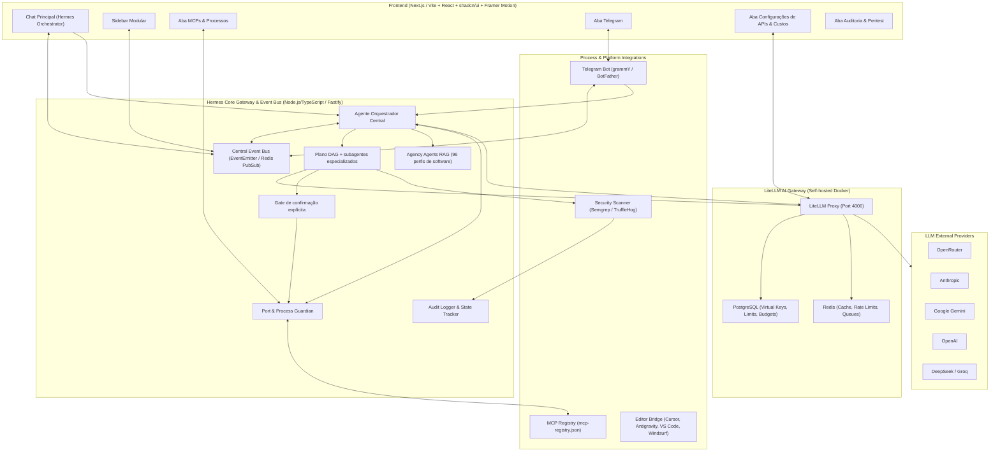

# ARCHITECTURE — HERMES CONTROL CENTER
Plataforma modular de orquestração de agentes de desenvolvimento, cibersegurança e automação.

`POST /api/orchestrator/run` executa capacidades configuradas. `POST /api/orchestrator/coordinate` valida e agenda módulos por dependência; subagentes retornam entregáveis textuais e a síntese não altera arquivos ou serviços. Ações com efeitos externos permanecem nas rotas próprias e exigem confirmação explícita.

O RAG `agency-agents` indexa fichas resumidas dos perfis de engenharia, design, QA/testes e segurança do repositório [msitarzewski/agency-agents](https://github.com/msitarzewski/agency-agents). `/run` recupera até quatro referências e `/coordinate` até três por tarefa; isso adiciona contexto, não cria novos subagentes. O seed é explícito via `POST /api/memory/seed-agency-agents`.

## Módulos Principais e Dependências

1. **Módulo 00: Core Foundation & Event Bus** (Eventos, Logs de auditoria, Registry central, Tipagens).
2. **Módulo 01: LiteLLM Gateway & Virtual Keys** (Roteamento de provedores, controle de custos em tempo real, virtual keys seguras).
3. **Módulo 02: Port & Process Guardian + MCP Manager** (Inventário psutil/netstat, monitoramento de portas, ciclo de vida de MCPs).
4. **Módulo 03: Hermes Orchestrator Agent & Anti-Sycophancy Engine** (Raciocínio sequencial, personas "Advogado do Diabo", delegação para subagentes).
5. **Módulo 04: Telegram Bridge 1-to-1** (grammY bot, fila FIFO local, notificações de incidentes e gates).
6. **Módulo 05: Security, Pentest & Quality Gates** (Semgrep, TruffleHog, verificação de segredos e conformidade).
7. **Módulo 06: Frontend Dashboard & Modular Sidebar** (shadcn/ui, Framer Motion, visualização de custos, MCPs e chats).
8. **Módulo 10: Agency Agents Reference RAG** (fichas atribuídas/versionadas de 96 perfis de software, recuperação semântica no orquestrador; sem delegação externa automática).
